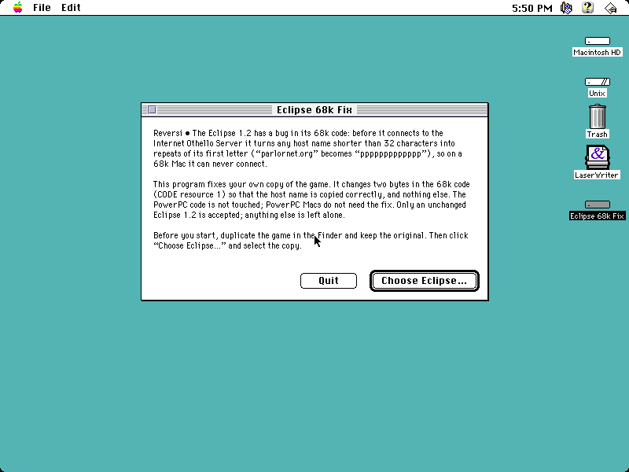

# Eclipse 68k Fix

**Eclipse 68k Fix** is a small classic Macintosh application that fixes a bug in your own
copy of *Reversi • The Eclipse 1.2* (Lars Graulund, published by Freeverse Software, 1997).
On 68k Macs the game cannot connect to the Internet Othello Server (IOS): it turns any host
name shorter than 32 characters into repeats of its first letter, so `parlornet.org` is looked
up as `ppppppppppppp`. The patcher changes two bytes in the game's 68k code and nothing else.

The game is not included here, and no patched copy is distributed: the patcher changes the
copy you already have.

Eclipse 68k Fix is part of [ParlorNet](https://github.com/eric-cgn/parlornet), a server for
period game programs, which plays Reversi with The Eclipse over IOS. This repository holds
the patcher and its build; the ParlorNet repository holds the server and its docs, and its
docs site serves the patcher's downloads.

## What it runs on

Any 68k Mac with System 7 or later. It also runs on PowerPC Macs as a 68k application, though
their copy of the game does not need the fix. It has been run on System 7.6.1 in Basilisk II
(see Testing).

## Getting it

The [Eclipse 68k Fix page](http://docs.parlornet.org/eclipse-68k-fix.html) of ParlorNet's
docs site has the downloads over plain HTTP, which a period browser can fetch. The same files
are on this repository's GitHub Releases, with their SHA-256 and MD5 sums:

- `eclipse-68k-fix.hqx`, BinHex 4.0, for a Mac that downloads text;
- `eclipse-68k-fix.bin`, MacBinary;
- `eclipse-68k-fix.dsk`, an 800K HFS disk image holding the application, for an emulator;
- `eclipse-68k-fix-readme.txt`, the README for the download, with the license.

## Installing

Decode the `.hqx` with StuffIt Expander or BinHex 4.0, or the `.bin` with any MacBinary tool,
or mount the `.dsk`, and copy **Eclipse 68k Fix** anywhere on your Mac. It needs no other files
and writes nothing but the fix to the copy of the game you choose.

## Using it

1. Duplicate *Reversi • The Eclipse 1.2* in the Finder and keep the original.
2. Open **Eclipse 68k Fix**. Its window explains what it does.
3. Click **Choose Eclipse…** and select the copy. The file dialog lists only applications
   with the game's creator code (`LPRV`).
4. The patcher reads resource `CODE` 1 and then says one of:
   - the copy is already fixed (nothing changed);
   - it is not *Reversi • The Eclipse 1.2* as shipped (nothing changed);
   - or it asks you to confirm, writes the fix, reads it back from disk and reports the result.

It refuses to write, with a message saying why, if the file is locked, the disk is locked or
read-only, the game is running, or the file is in use. PowerPC Macs do not need the fix, but
patching a copy that is also used on a PowerPC Mac is harmless: the PowerPC code is in the
data fork and is not touched.

## What it changes

| | |
|---|---|
| resource | `CODE` 1 ("Eclipse source"), 141,796 bytes |
| place | code offset `0x16D52` (offset `0x16D56` in the resource data, after the 4-byte segment header; resource fork file offset `0x1EB7EC` in the copy examined) |
| bytes | `65 04` (`bcs.b`) → `4E 71` (`nop`) |
| unchanged | data fork (PowerPC code), Finder info, every other resource |

Before writing, the patcher checks that `CODE` 1 has exactly the expected size, that the
branch holds either the shipped bytes or the fix, that a SHA-256 hash of the 64 bytes around
the branch matches, and that a CRC-32 of the whole resource matches *Eclipse 1.2* (both with
the two bytes taken as shipped). Any other version or altered copy is left alone. The
patcher stores only these digests, not the game's bytes. Hashing the 64 bytes takes two
SHA-256 blocks, a small fraction of the time the CRC-32 of the whole resource takes.
The write goes through the Resource Manager (`ChangedResource`, `WriteResource`,
`UpdateResFile`); `CODE` 1 is a protected resource, so the patcher clears the protected bit
for the write and puts the original attributes back.

## The bug

The game is a fat application: PowerPC code in the data fork, 68k code in `CODE` resources.
When it connects, the `MyTelnet` constructor copies the host name into a 256-byte buffer as a
C string and then turns it into a Pascal string in place, by moving the characters up one
byte with `memcpy(buf + 1, buf, n)` and storing the length in `buf[0]`.

`memcpy` does not promise to handle overlapping blocks. CodeWarrior's 68k compiler expands
it inline: for 32 bytes or more it calls `_BlockMoveData`, which does handle overlap, but for
shorter lengths it uses a forward byte loop. Copying forward one byte up repeats the first
byte all the way along, so every name under 32 characters comes out as one letter repeated
(the game's own default, `external.nj.nec.com`, included; numeric addresses too). The
PowerPC build of the same source calls `BlockMoveData` for every length, which is why the
game connects from a PowerPC Mac. The fault is in the game's 68k code, so it shows on a real
68k Mac as well as in an emulator.

| code offset | what the code does there |
|---|---|
| `16d44`-`16d4c` | loads the destination (`buf + 1`) into `a1`, the source (`buf`) into `a0` and the length into `d0` |
| `16d4e`-`16d50` | compares the length with 32 |
| `16d52` | `bcs.b` to the byte loop at `16d58` when the length is under 32 (the branch the fix replaces with `nop`) |
| `16d54` | calls `_BlockMoveData`, which is overlap-safe, for 32 bytes or more |
| `16d56` | branches past the loop |
| `16d58` | the forward byte loop |

With the branch replaced by `nop`, every length takes the `_BlockMoveData` path the code
already uses for long names. `d0`, `a0` and `a1` already hold the length, source and
destination there, so nothing else needs to change.

## Building

You need Docker and Python 3. The application is built with
[Retro68](https://github.com/autc04/Retro68) (GCC for classic Mac OS) from its Docker image,
pinned by digest in the build script. From the top of the repository:

```sh
tools/build.sh
```

It writes `build/eclipse-68k-fix.bin`, `.hqx` (made from the `.bin` by `tools/binhex4.py`) and
`.dsk`; the application is type `APPL`, creator `EcFx`. The dates in the files are set to the
release date by `tools/patcher_dates.py`, so the same source always gives the same files. It
also puts the release files in `build/release/`: those three, the README from `release/`, and
`SHA256SUMS` and `MD5SUMS`. `RETRO68_IMAGE` names another toolchain image.

Source: `src/main.c` (the application), `src/patch.c` (the check and the patch, no Toolbox
calls), `src/EclipseFix.r` (menus, alerts, `vers`, `SIZE`).

## Branches and releases

Changes go into `dev` by pull request, squashed; `main` takes only merges from `dev`, which is
how a release is made. Every pull request and every push to `main` builds and tests
(`.github/workflows/ci.yml`), and a pull request into `main` fails unless it comes from `dev`.
Every push to `dev` publishes a `dev` pre-release that replaces the last one, with files named
for the version, `-dev-` and the commit, such as `eclipse-68k-fix-1.0-dev-46a0304.hqx`
(`.github/workflows/dev.yml`).

A push to `main` whose version (the one in `src/EclipseFix.r`) has no release yet runs the
release (`.github/workflows/release.yml`): it builds the same way, runs the tests, tags the
commit `v<version>` (`v1.0` for 1.0) and publishes the files as a GitHub Release with their
sums. ParlorNet's docs site takes the files from that release, at a tag it pins, and checks
each one's SHA-256 before it serves it.

## Testing

`src/patch.c` is also compiled natively and tested by `test/test_patch.c`. Neither the game
nor any of its code is in this repository, so `make test` on its own checks the SHA-256
routine against the FIPS 180-4 examples, checks that the stored digests are the values
recorded from the copy examined, and runs the check and the patch on a synthetic `CODE` 1
(pseudo-random bytes with the shipped branch at the patch site) whose reference digests the
test computes itself. To test against a real copy as well, point it at your own copy's
resource fork and at a copy patched by hand (for example the `.rsrc/` files of a netatalk or
Basilisk II shared folder):

```sh
make test ORIG="path/to/.rsrc/Reversi • The Eclipse 1.2" REF="path/to/patched.rsrc"
```

With a real copy it also checks the window's SHA-256 against the recorded value, that the
routine produces exactly the reference bytes (two bytes changed), and that it recognizes the
result and the reference as already fixed and leaves them alone. In both cases it checks that
the routine refuses copies with a byte changed in the window, far from it (CRC), at the branch
itself, or with a different `CODE` 1 size. `python3 -m unittest discover -s tests` runs the same
test, checks the sources and, once `tools/build.sh` has run, the built files. With
`ECLIPSE_ORIG_RSRC` and `ECLIPSE_REF_RSRC` set it also checks that no run of the window's bytes
appears in the patcher's files, its README or the built downloads; `ECLIPSE_EXTRA_FILES` adds
other files to that check, such as ParlorNet's pages about the bug.

It was also run in Basilisk II (68030, System 7.6.1, a copy of a local disk image; no network),
with the application installed from the `.bin` and the `.dsk` mounted:

- the window, the file dialog (only `LPRV` applications listed), About, and Quit;
- a copy of the game on a shared host folder: fixed, then compared with the reference: the
  data fork and Finder info are unchanged and the resource fork equals the reference in its
  header and data area (the `CODE` 1 data written in place). The only other differences are
  in the resource map's reserved fields, which the Resource Manager rewrites
  when it saves the map (the next-map handle and file reference number, and the in-memory
  handle slots of three resource entries); resource attributes are unchanged;
- a copy on an HFS volume: fixed, read back, and the fixed game launched and ran;
- refusals: an already fixed copy, a copy with one byte changed in `CODE` 1, a locked file,
  a file on a locked disk, and a copy of the game that was running;
- the build that checks the window by its SHA-256 (the earlier build compared the bytes
  themselves): a copy fixed by it has the same data fork, resource fork and Finder info,
  byte for byte, as a copy fixed by the earlier build, each build sees the other's result as
  already fixed, and a copy with one byte of the window changed is refused.



## Background

Version 1.2, uploaded to Info-Mac by Freeverse on 14 November 1997, appears to be the last
release, and no later version or patch was ever published. No report of this bug is known.
Freeverse's FAQ said "There are no known bugs in Eclipse" from 1998 to 2000 and put Internet
login failures down to a busy server, a name in use or a firewall. The bug probably went
unnoticed because the game's IOS play stopped working on every platform soon after release,
when the server moved and was later replaced by GGS.

## The game

*Reversi • The Eclipse* is by Lars Graulund and was published by Freeverse Software. This
patcher is not affiliated with either and contains none of the game.

## License and notices

Eclipse 68k Fix is ParlorNet's own code, under the MIT license; see [LICENSE](LICENSE). The
release README carries the same text. The game's name is used only to say which program the
patcher fixes.

## Contributing

See [CONTRIBUTING.md](CONTRIBUTING.md).
